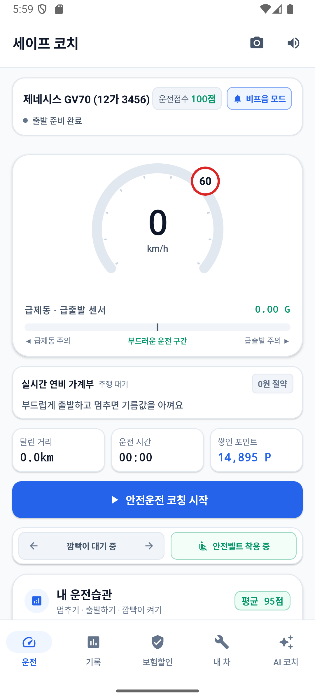
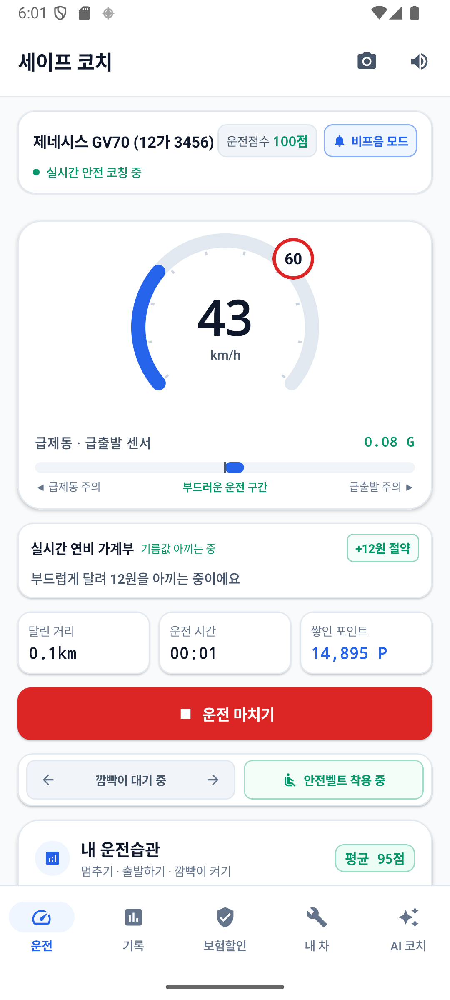
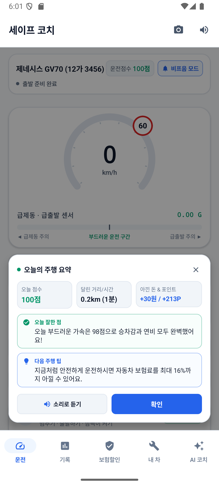
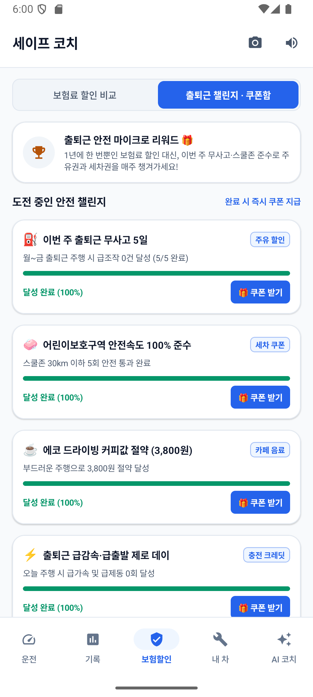

# 🚗 카포켓 (CarPocket)

> **"달릴수록 차곡차곡 쌓이는 내 차 전용 머니포켓 & 스마트 드라이빙 코파일럿"**

---

## 💡 서비스 소개 (Overview)

**카포켓 (CarPocket)**은 차량 주행 데이터를 실시간으로 분석하여 안전 운전을 유도하고, 아낀 기름값과 보험료 환급 혜택을 **내 차 전용 저금통(Money Pocket)**에 차곡차곡 모아주는 차세대 스마트 모빌리티 핀테크 애플리케이션입니다.

---

## ✨ 7대 핵심 고도화 기능 (Key Features)

### 1. 도착 직후 30초 '퀵 디브리핑 (Quick Debrief)'
- 주행 중 잦은 음성 안내를 차단하고 필수 경고음만 전달하는 **비프음 간소화 모드** 지원.
- 목적지 도착 및 시동 OFF 시 Gleo AI가 **"오늘의 점수 + 아낀 돈 + 칭찬 1가지 + 핵심 팁 1가지"**를 요약 카드 및 음성 브리핑으로 전달.

### 2. 실시간 '연비 화폐 환산' 가계부 코칭
- "급가속 3회" 대신 센서 데이터 기반 즉각적인 화폐 가치 환산:
  - *"방금 급출발로 약 180원이 더 소모됐어요 ⚡"*
  - *"오늘 부드러운 주행으로 커피 한 잔 값(3,800원)을 아꼈어요! ☕"*

### 3. 주정차 단속 '골든타임' 10분 유예 자동 타이머
- 주정차 단속 구간 정차 감지 시 공공데이터 기반 **유예시간(10분) 자동 카운트다운**.
- 점심시간 유예(11:30~14:00) 자동 반영 및 **단속 확정 5분 전 긴급 이동 푸시/음성 알림** 제공.

### 4. Gleo 음성 AI 기반 '3초 감정 케어 & 보복운전 예방'
- 급격한 끼어들기 및 직후 급제동·추격 가속 패턴 감지 시 Gleo AI 즉각 개입.
- 3초 펄스 호흡 가이드 및 차분한 목소리로 *"방금 상황은 정말 놀라셨겠어요. 심호흡 한 번 하고 거리를 두세요"* 코칭을 제공하여 2차 사고 예방.

### 5. 카메라 비전 '주차장 기억 & 문콕 방어 가이드'
- 대형 마트/백화점 주차 시 카메라 비전으로 **지하 3층 D-12 기둥 구역 번호 자동 OCR 인식**.
- 좌우 간격 분석(우측 기둥 밀착 안심 가이드) 및 Gleo AI에게 *"내 차 어디 있어?"* 질의 시 즉각 위치와 사진 안내.

### 6. 주차 요금 표지판 '1초 계산기'
- 복잡한 요금표 스캔 후 예상 주차 시간(1h/2h/4h/종일)별 최종 요금 및 일 최대 상한가 자동 계산.
- **15분 무료 회차 시간**을 직관적으로 강조 브리핑.

### 7. 출퇴근 안전 챌린지 마이크로 리워드 & 모바일 쿠폰함
- 1년에 1번 받는 보험료 할인을 넘어, **'이번 주 출퇴근 무사고', '스쿨존 100% 준수'** 등 주간/월간 미션 달성 시 즉시 모바일 쿠폰(주유권, 세차권, 전기차 충전 크레딧) 지급.
- 캔버스 기반 실시간 바코드 렌더링 및 매장 현장 사용 기능 탑재.

---

## 🛠️ 기술 스택 (Tech Stack)

* **언어 (Language)**: Kotlin 2.0+
* **UI 프레임워크**: Jetpack Compose, Material 3
* **아키텍처**: MVVM, Repository Pattern, Factory Pattern (SRP/Clean Code)
* **비동기 처리**: Kotlin Coroutines & StateFlow / SharedFlow
* **AI 엔진**: Gleo AI Engine (Gemini Interactions API 연동)
* **음성/햅틱 코칭**: Android Text-To-Speech (TTS) & VibratorManager Haptics
* **포그라운드 서비스**: DrivingTrackerService (백그라운드 주행 모니터링)
* **테스트**: Robolectric, JUnit 4 (33개 단위 테스트 검증 완료)

---

## 📐 디자인 시스템 (Design Standards)

* **토스 & 애플 스타일 카피라이팅**: 군더더기 없는 명확하고 따뜻한 어조.
* **Anti-Squishing**: 모든 Row 가변 텍스트에 `weight(1f, fill = false)` 및 `TextOverflow.Ellipsis` 적용.
* **Zero Decorative Icons**: 텍스트 우선(Text-First) 및 기능성 단색 Material 벡터 아이콘.
* **핀테크 뉴트럴 컬러**: 다크 슬레이트(`#0f172a`), 뉴트럴 캡슐(`LightSurfaceSubtle`), 포인트 블루 틴트(`#2563EB`).
* **모던 피드백 팝업**: 24dp 라운디드 코너, 52% 백드롭 스크림, 상단 다이내믹 아일랜드형 플로팅 토스트.

---

## 📱 스크린샷 (Screenshots)

| 메인 콕핏 | 실시간 코칭 | 퀵 디브리핑 | 출퇴근 챌린지 |
|:---:|:---:|:---:|:---:|
|  |  |  |  |

---

## 📄 라이선스 (License)

Copyright © 2026 CarPocket Team. All rights reserved.
